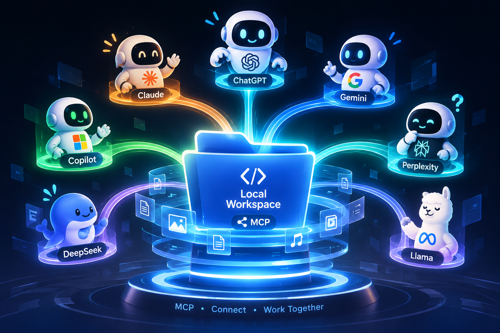

# Local Workspace MCP

<p align="center">
  
</p>

<p align="center">
  <strong>Satu folder di PC kamu, bisa dibaca dan ditulis oleh AI mana pun.</strong><br>
  <strong>One folder on your machine that any AI can read and write.</strong>
</p>

<p align="center">
  <a href="#bahasa-indonesia">Bahasa Indonesia</a> &nbsp;·&nbsp; <a href="#english">English</a>
</p>

---

## Bahasa Indonesia

### Apa ini?

Local Workspace MCP berjalan sepenuhnya di komputermu. Ada dua bagian:

1. **Editor web** di `http://127.0.0.1:43787` — file tree, edit, autosave, buat/rename/hapus file.
2. **Server MCP** — protokol yang dipakai Claude, ChatGPT, Gemini, Copilot, opencode, Cursor dan lainnya untuk memanggil *tools*. Lewat MCP, AI bisa membaca file, menulis kode, mengedit sebagian, menyusun struktur folder, mencari teks, dan menghapus file — langsung di disk kamu.

Tidak ada cloud, tidak ada akun, tidak ada database, tidak ada telemetri. Hanya Node.js dan dua dependency. Untuk akses dari luar, satu perintah `ssh` lewat localhost.run sudah cukup — tanpa domain, tanpa Cloudflare, tanpa kartu kredit.

### Kelebihan

| Kelebihan | Penjelasan |
|---|---|
| **Satu workspace, banyak AI** | Semua client MCP memakai folder yang sama. Ganti AI tanpa memindahkan file. |
| **Langsung ke disk** | AI menulis file asli, bukan potongan kode di chat. Penulisan atomik, folder induk dibuat otomatis. |
| **11 tool siap pakai** | Baca, tulis, edit sebagian, scaffold struktur, cari, pindah, hapus. |
| **Dua mode koneksi** | `stdio` (paling aman, tanpa jaringan) dan HTTP `/mcp` untuk remote. |
| **Publik tanpa akun** | localhost.run: tanpa domain, tanpa akun, tanpa build step. |
| **Editor yang tidak mengganggu** | Autosave 700 ms, Ctrl+S, Tab = 2 spasi, indikator Ln/Col. |
| **Sandbox** | Semua operasi dikunci ke satu folder; path traversal dan symlink keluar ditolak. |
| **Bisa diaudit** | Setiap tulis, edit, pindah, dan hapus dicatat di `.logs/activity.jsonl`. |
| **Ringan** | Tanpa framework, tanpa DB, tanpa bundler. `npm install` lalu `npm start`. |
| **Lintas OS** | Windows, macOS, Linux. |

### Cara menjalankan

Prasyarat: **Node.js 18.17+**. OpenSSH client hanya dibutuhkan kalau ingin tunnel publik (`ssh -V`).

```bash
git clone https://github.com/rinaldisign/local-workspace-mcp.git
cd local-workspace-mcp
npm install
npm start
```

Di Windows: klik dua kali `start.bat`, atau jalankan `npm.cmd install` lalu `npm.cmd start`.

Saat pertama jalan, token dibuat otomatis di `.token` dan dicetak di terminal:

```
Editor UI   : http://127.0.0.1:43787
MCP (local) : http://127.0.0.1:43787/mcp
Workspace   : ...\local-workspace-mcp\workspace
TOKEN       : 3f9c...
```

Buka `http://127.0.0.1:43787`, tempel token sekali (disimpan di browser).

**Pilih folder kerja:** isi path absolut di kolom `folder` pada header, klik **use**. Kalau foldernya belum ada, kamu akan ditanya apakah mau dibuat. Pilihan disimpan di `config.json` dan dipakai lagi saat start berikutnya.

Urutan prioritas: `config.json` → `WORKSPACE_DIR` di `.env` → `./workspace`. Root drive (`C:\`) dan folder sistem ditolak.

### Akses publik dengan localhost.run

Dua terminal:

```bash
npm start          # terminal 1 - aplikasi
npm run tunnel     # terminal 2 - tunnel
```

Perintah mentahnya:

```bash
ssh -o ServerAliveInterval=30 -R 80:localhost:43787 nokey@localhost.run
```

Terminal tunnel mencetak URL seperti `https://a1b2c3d4.lhr.life`. URL MCP-mu:

```
https://a1b2c3d4.lhr.life/mcp
```

URL berubah setiap sesi dan hanya hidup selama kedua proses berjalan.

### Hubungkan AI

**opencode — stdio (paling aman)**, `~/.config/opencode/opencode.json`:

```json
{
  "mcp": {
    "local-workspace": {
      "type": "local",
      "command": ["node", "/path/ke/local-workspace-mcp/mcp-stdio.js"],
      "enabled": true
    }
  }
}
```

**opencode — remote lewat tunnel:**

```json
{
  "mcp": {
    "local-workspace-http": {
      "type": "remote",
      "url": "https://a1b2c3d4.lhr.life/mcp",
      "headers": { "Authorization": "Bearer <TOKEN>" },
      "enabled": true
    }
  }
}
```

**Claude Desktop — stdio:**

```json
{
  "mcpServers": {
    "local-workspace": {
      "command": "node",
      "args": ["/path/ke/local-workspace-mcp/mcp-stdio.js"]
    }
  }
}
```

**Claude / client lain — remote:** *Settings → Connectors → Add custom connector*, isi `https://a1b2c3d4.lhr.life/mcp`. Kalau UI-nya mendukung header, tambahkan `Authorization: Bearer <TOKEN>`.

Setelah tersambung, cukup minta: *"buat landing page di workspace saya"* — AI memanggil `create_tree` / `save_code` dan file benar-benar muncul di disk.

### Keamanan

- Default-nya **token aktif** (`OPEN_MODE=false`). Pertahankan begitu.
- `OPEN_MODE=true` mematikan auth sepenuhnya: siapa pun yang bisa mencapai URL itu bisa membaca, menulis, dan menghapus file. Hanya untuk uji lokal — **jangan** dipakai bersamaan dengan tunnel publik.
- URL tunnel itu publik, bukan rahasia. Hanya token yang membatasi akses.
- Server hanya bind ke `127.0.0.1`, jadi tidak terbuka ke LAN.
- Jangan menaruh kredensial di folder workspace selama tunnel hidup; trafik melewati server pihak ketiga.
- Persempit permukaan dengan `ALLOWED_EXTENSIONS` dan `MAX_FILE_BYTES`. Semua perubahan tercatat di `.logs/activity.jsonl`.

Detail lengkap: [SECURITY.md](SECURITY.md).

---

## English

### What is this?

Local Workspace MCP runs entirely on your computer. Two parts:

1. **Web editor** at `http://127.0.0.1:43787` — file tree, editing, autosave, create/rename/delete.
2. **MCP server** — the protocol Claude, ChatGPT, Gemini, Copilot, opencode, Cursor and others use to call *tools*. Over MCP an AI can read files, write code, patch part of a file, scaffold folders, search text, and delete files directly on your disk.

No cloud, no account, no database, no telemetry. Just Node.js and two dependencies. For remote access, one `ssh` command through localhost.run is enough — no domain, no Cloudflare, no credit card.

### Why use it

| Advantage | Details |
|---|---|
| **One workspace, many AIs** | Every MCP client shares the same folder. Switch AI without moving files. |
| **Straight to disk** | The AI writes real files, not chat snippets. Atomic writes, parent folders created. |
| **11 ready-made tools** | Read, write, patch, scaffold, search, move, delete. |
| **Two transports** | `stdio` (safest, no network) and HTTP `/mcp` for remote. |
| **Public without an account** | localhost.run: no domain, no signup, no build step. |
| **Editor that stays out of the way** | 700 ms autosave, Ctrl+S, Tab = 2 spaces, Ln/Col. |
| **Sandboxed** | Locked to one folder; path traversal and escaping symlinks are rejected. |
| **Auditable** | Every write, edit, move and delete is appended to `.logs/activity.jsonl`. |
| **Lightweight** | No framework, no DB, no bundler. `npm install` then `npm start`. |
| **Cross-platform** | Windows, macOS, Linux. |

### How to run

Requires **Node.js 18.17+**. An OpenSSH client is only needed for the public tunnel (`ssh -V`).

```bash
git clone https://github.com/rinaldisign/local-workspace-mcp.git
cd local-workspace-mcp
npm install
npm start
```

On Windows, double-click `start.bat`, or run `npm.cmd install` then `npm.cmd start`.

On first run a token is generated into `.token` and printed:

```
Editor UI   : http://127.0.0.1:43787
MCP (local) : http://127.0.0.1:43787/mcp
Workspace   : ...\local-workspace-mcp\workspace
TOKEN       : 3f9c...
```

Open `http://127.0.0.1:43787` and paste the token once (kept in your browser).

**Pick the working folder:** put an absolute path in the `folder` box in the header and click **use**. If the folder does not exist you will be asked whether to create it. The choice is saved in `config.json` and reused on the next start.

Priority: `config.json` → `WORKSPACE_DIR` in `.env` → `./workspace`. Drive roots (`C:\`) and system folders are refused.

### Public access with localhost.run

Two terminals:

```bash
npm start          # terminal 1 - the app
npm run tunnel     # terminal 2 - the tunnel
```

Raw command:

```bash
ssh -o ServerAliveInterval=30 -R 80:localhost:43787 nokey@localhost.run
```

The tunnel prints a URL such as `https://a1b2c3d4.lhr.life`. Your MCP URL is:

```
https://a1b2c3d4.lhr.life/mcp
```

The URL changes every session and only lives while both processes are running.

### Connect an AI

**opencode — stdio (safest)**, `~/.config/opencode/opencode.json`:

```json
{
  "mcp": {
    "local-workspace": {
      "type": "local",
      "command": ["node", "/path/to/local-workspace-mcp/mcp-stdio.js"],
      "enabled": true
    }
  }
}
```

**opencode — remote through the tunnel:**

```json
{
  "mcp": {
    "local-workspace-http": {
      "type": "remote",
      "url": "https://a1b2c3d4.lhr.life/mcp",
      "headers": { "Authorization": "Bearer <TOKEN>" },
      "enabled": true
    }
  }
}
```

**Claude Desktop — stdio:**

```json
{
  "mcpServers": {
    "local-workspace": {
      "command": "node",
      "args": ["/path/to/local-workspace-mcp/mcp-stdio.js"]
    }
  }
}
```

**Claude / other clients — remote:** *Settings → Connectors → Add custom connector* and paste `https://a1b2c3d4.lhr.life/mcp`. If the UI supports headers, add `Authorization: Bearer <TOKEN>`.

Then just ask: *"make a landing page in my workspace"* — the AI calls `create_tree` / `save_code` and the files appear on disk.

### Security

- **Token mode is the default** (`OPEN_MODE=false`). Keep it.
- `OPEN_MODE=true` disables auth entirely: anyone who can reach the URL can read, write and delete files. Local testing only — **never** alongside a public tunnel.
- A tunnel URL is public, not secret. Only the token restricts access.
- The server binds to `127.0.0.1` only, so it is not reachable from your LAN.
- Do not keep credentials in the workspace while a tunnel is live; traffic passes through a third-party server.
- Narrow the surface with `ALLOWED_EXTENSIONS` and `MAX_FILE_BYTES`. Every change is logged to `.logs/activity.jsonl`.

Full details: [SECURITY.md](SECURITY.md).

---

## Reference

### MCP tools

| Tool | What it does |
|---|---|
| `workspace_info` | absolute path, limits, allowed extensions, folder categories |
| `list_files` | recursive tree (bounded) |
| `read_file` | read one text file |
| `write_file` | write a full file (atomic, parent dirs created) |
| `edit_file` | replace unique text, or `replaceAll` |
| `save_code` | save into a category folder by extension |
| `create_tree` | scaffold many files/folders at once |
| `create_folder` | recursive `mkdir` |
| `move_path` | move / rename |
| `delete_path` | delete file or folder |
| `search_files` | text search across the workspace |

`save_code` category mapping:

| Extension | Folder |
|---|---|
| `.html` | `pages/` |
| `.css` | `styles/` |
| `.js` `.ts` `.jsx` `.tsx` | `scripts/` |
| `.json` `.csv` `.sql` | `data/` |
| `.md` `.txt` | `docs/` |
| `.svg` `.png` `.jpg` … | `assets/` |
| `.yml` `.toml` `.env` | `config/` |
| anything else | `misc/` |

### REST API

All `/api/*` routes need `Authorization: Bearer <TOKEN>` (skipped in `OPEN_MODE`) and return JSON `{ ok: true | false }`.

| Method | Path | Body |
|---|---|---|
| GET | `/health` | – (public, includes `openMode`) |
| GET | `/api/info` | – |
| GET \| POST | `/api/settings` | `{ workspace, create? }` |
| GET | `/api/tree?path=` | – |
| GET | `/api/file?path=` | – |
| POST | `/api/file` | `{ path, content }` |
| POST | `/api/edit` | `{ path, oldText, newText, replaceAll? }` |
| POST | `/api/structure` | `{ entries: [{ path, type, content }] }` |
| POST | `/api/folder` | `{ path }` |
| POST | `/api/move` | `{ from, to }` |
| POST | `/api/delete` | `{ path }` |
| POST | `/api/search` | `{ query, path?, maxResults? }` |
| ALL | `/mcp` | MCP JSON-RPC |

Quick check:

```bash
curl http://127.0.0.1:43787/api/info -H "Authorization: Bearer <TOKEN>"
curl -s https://a1b2c3d4.lhr.life/mcp \
  -H 'Accept: application/json, text/event-stream' \
  -H 'Content-Type: application/json' \
  -d '{"jsonrpc":"2.0","id":1,"method":"tools/list","params":{}}'
```

### Configuration / Konfigurasi

Copy `.env.example` to `.env` and edit:

| Variable | Default | Meaning |
|---|---|---|
| `PORT` | `43787` | HTTP port |
| `HOST` | `127.0.0.1` | bind address (keep loopback for tunnels) |
| `WORKSPACE_DIR` | `./workspace` | initial workspace folder |
| `AUTH_TOKEN` | – | fixed token (otherwise generated into `.token`) |
| `OPEN_MODE` | `false` | `true` disables auth entirely |
| `MAX_FILE_BYTES` | `2097152` | max file size (2 MB) |
| `MAX_TREE_ENTRIES` | `5000` | max tree entries returned |
| `ALLOWED_EXTENSIONS` | built-in list | comma-separated writable extensions |

Never committed (see `.gitignore`): `.env`, `.token`, `config.json`, `.logs/`, `workspace/`, `node_modules/`.

### Troubleshooting

| Symptom | Fix |
|---|---|
| `npm.ps1 cannot be loaded` (Windows) | use `npm.cmd install`, or `Set-ExecutionPolicy -Scope CurrentUser RemoteSigned` |
| Port already in use | change `PORT` in `.env` and restart |
| UI keeps asking for a token | paste the value from `.token`, or the `TOKEN` line in the terminal |
| AI writes but nothing appears | the AI writes to the workspace folder, not this repo — check the `folder` box |
| `Extension .xyz is not allowed` | add it to `ALLOWED_EXTENSIONS` |
| Tunnel URL stopped working | the SSH session ended; rerun `npm run tunnel` (new URL) |
| `ssh: command not found` | install the OpenSSH client |

## Project layout / Struktur proyek

```
server.js         HTTP: static UI + REST + MCP
mcp-stdio.js      stdio transport entry point
mcp-core.js       11 MCP tools
lib/config.js     env loader, token, OPEN_MODE, config.json
lib/fs-service.js filesystem core (sandbox, atomic writes, search)
public/index.html single-page editor
public/app.js     editor logic (autosave, tree, modals)
public/styles.css theme
start.bat|.sh     start the app
tunnel.bat|.sh    start the localhost.run tunnel
docs/hero.png     repository banner
```

## License / Lisensi

MIT — see [LICENSE](LICENSE).

## Disclaimer

The banner image is fan art that includes third-party AI product names and logos for illustration only. This project is not affiliated with, endorsed by, or sponsored by OpenAI, Anthropic, Google, Microsoft, DeepSeek, Perplexity, or Meta.
